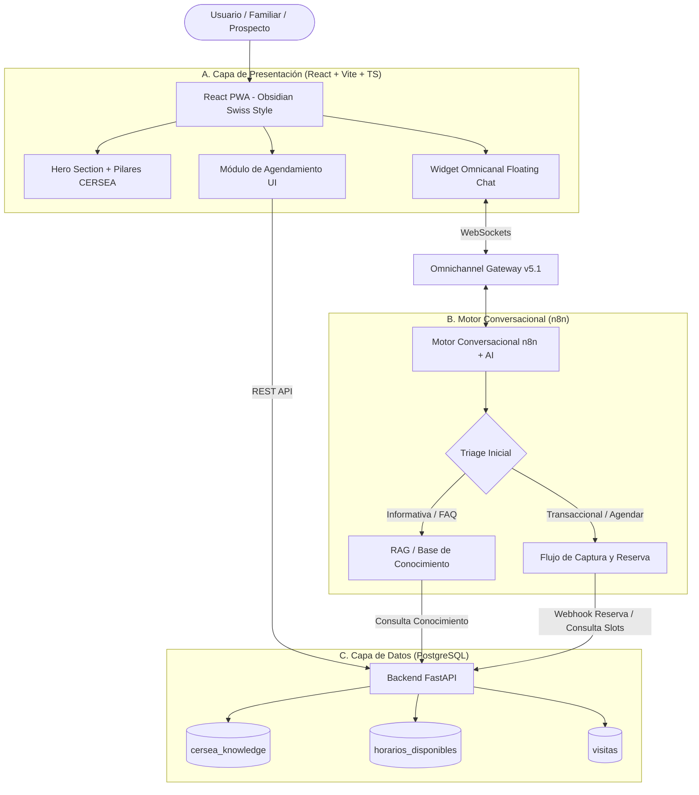

# Arquitectura del Sistema y Flujo de Datos

## 🏛️ Proyecto: CERSEA WEB & BOT (Centro Cersea)

### Visión General
Progressive Web App (PWA) informativa y transaccional para **CERSEA, A.C. (Centro de Rehabilitación Sembrando Amor)** en San Luis Río Colorado. Integra un calendario de agendamiento directo y un asistente conversacional empático conectado vía WebSockets (Omnichannel Gateway v5.1 + n8n) respaldado por FastAPI y PostgreSQL.

---

### Diagrama de Arquitectura y Flujo (Mermaid)

---

### Blueprint Detallado de Arquitectura

#### A. Capa de Presentación (React PWA)
- **Estilo Visual:** *Obsidian Swiss Style* (Dark glassmorphic, fondos `#030712` / `#0b0f19`, acentos verde neón `#00FF66` para sanación/esperanza, tipografía `JetBrains Mono`).
- **Hero Section:**
  - Título principal e identidad de CERSEA, A.C.
  - Llamado a la acción (CTA) directo al chat y agendamiento.
  - Resumen de los pilares fundamentales:
    1. **Atención Psicológica**
    2. **CUSON**
    3. **ISEA**
    4. **Doctrina Cristiana**
- **Widget Omnicanal (Floating Chat):**
  - Componente persistente en la esquina inferior derecha.
  - Conectado en tiempo real vía **WebSockets** al **Omnichannel Gateway v5.1**.
  - Apertura proactiva: *"Hola, bienvenido a CERSEA. ¿Buscas información sobre nuestros procesos de ingreso o deseas agendar una visita?"*
- **Módulo de Agendamiento UI:**
  - Alternativa visual directa al bot.
  - Calendario limpio que consume los endpoints de FastAPI para mostrar slots disponibles (`horarios_disponibles`) y permite reservar directamente (`visitas`).

#### B. Motor Conversacional y Flujo Lógico (n8n + AI)
- **Lineamiento Conversacional:** Actúa con empatía, profesionalismo y bajo los lineamientos cristianos y humanistas del centro.
- **Triage Inicial:** El bot clasifica la intención del usuario en **Informativa (FAQ)** o **Transaccional (Agendar)**.
- **RAG / Base de Conocimiento:**
  - **Ubicaciones:** Callejón Jalisco / Callejón Oaxaca (San Luis Río Colorado).
  - **Servicios:** Análisis clínicos, nutrición, educación, atención psicológica.
  - **Convenios:** CUSON, ISEA.
  - **Contactos:** `653 123 2800` / `653 534 6760`.
- **Slot de Agendamiento:**
  - Si la intención es reservar, el bot solicita en secuencia:
    1. **Nombre del Familiar** (`nombre_visitante`)
    2. **Teléfono** (`telefono`)
    3. **Nombre del Interno/Prospecto** y tipo de visita (`Primer Ingreso` o `Familiar`)
    4. **Preferencia de Horario** (`fecha_hora`)
  - Dispara un webhook hacia **FastAPI** para validar disponibilidad con control de concurrencia y bloquear/registrar el slot en PostgreSQL.

#### C. Capa de Datos (PostgreSQL)
Tres tablas principales gestionadas desde FastAPI:
1. `cersea_knowledge`: Preguntas, respuestas y contexto institucional para inyectar al prompt del bot.
2. `visitas`: Registro transaccional de citas agendadas (Primer Ingreso / Familiar) y su estado (`Pendiente`, `Confirmada`, `Cancelada`).
3. `horarios_disponibles`: Bloques de tiempo permitidos por el centro para visitas (ej. fines de semana de 10:00 AM a 4:00 PM).

---

### Decisiones de Arquitectura (ADRs)
- **ADR-001:** Adopción de *Obsidian Swiss Style* (`#030712`, `#0b0f19`, `#00FF66`, `JetBrains Mono`) para transmitir serenidad, orden suizo y esperanza.
- **ADR-002:** Comunicación en tiempo real mediante **Omnichannel Gateway v5.1** por WebSockets hacia **n8n**, desacoplando la lógica conversacional del backend transaccional en **FastAPI**.
- **ADR-003:** Manejo de concurrencia en FastAPI + PostgreSQL al reservar horarios para evitar dobles reservas simultáneas desde el chat y la UI web.
