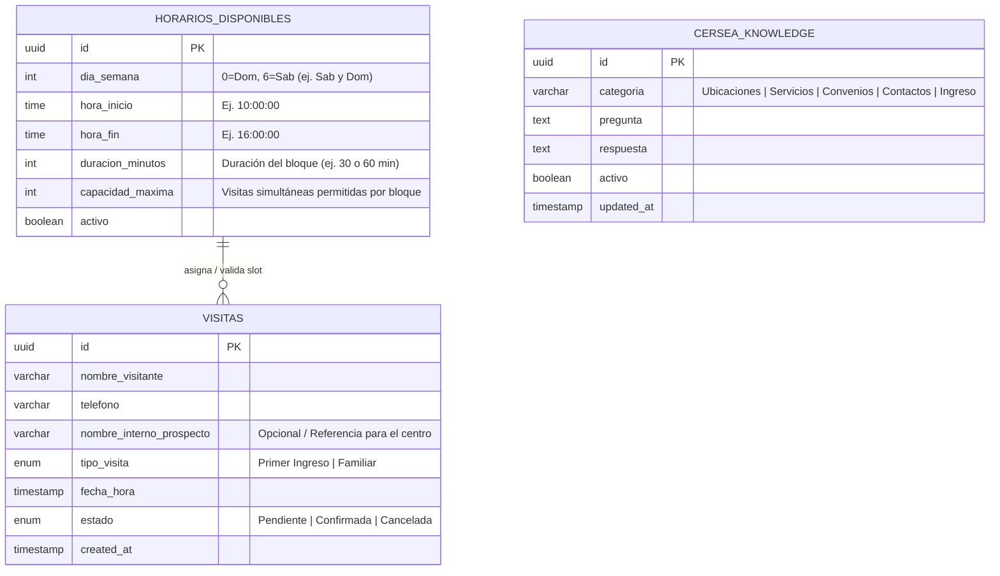

# Esquema Relacional y Capa de Datos (PostgreSQL)

## 💾 Proyecto: CERSEA WEB & BOT (Centro Cersea)

### Motor de Base de Datos
- **Motor:** PostgreSQL 16+
- **Extensiones Requeridas:** `uuid-ossp` (y opcionalmente `pgvector` para búsqueda semántica futura en `cersea_knowledge`).
- **ORM / Migraciones:** SQLAlchemy 2.0 (Async) / Alembic.
- **Requisito Crítico:** Control de concurrencia transaccional (`SELECT ... FOR UPDATE` o restricciones de unicidad/capacidad por slot) al agendar visitas para evitar colisiones de horario.

---

### Diagrama Entidad-Relación (Mermaid)

---

### Especificación de Tablas Principales

#### 1. `cersea_knowledge`
Almacena las preguntas y respuestas predefinidas e información oficial del centro para inyectar al prompt del bot (RAG / Context Injection).
- **Datos Semilla (Seed Data) clave:**
  - **Ubicaciones:** Callejón Jalisco y Callejón Oaxaca (San Luis Río Colorado, Sonora).
  - **Servicios:** Atención psicológica, análisis clínicos, nutrición, educación, doctrina cristiana.
  - **Convenios:** CUSON, ISEA.
  - **Contactos Oficiales:** `653 123 2800` / `653 534 6760`.

#### 2. `visitas`
Almacena las citas de valoración (Primer Ingreso) y visitas familiares agendadas desde el bot o desde el Módulo de Agendamiento UI.
| Columna | Tipo | Restricciones | Descripción |
| :--- | :--- | :--- | :--- |
| `id` | `UUID` | `PRIMARY KEY DEFAULT uuid_generate_v4()` | Identificador único de la cita |
| `nombre_visitante` | `VARCHAR(150)` | `NOT NULL` | Nombre completo del familiar o solicitante |
| `telefono` | `VARCHAR(30)` | `NOT NULL` | Teléfono de contacto (validado) |
| `nombre_interno_prospecto` | `VARCHAR(150)` | `NULL` | Nombre del interno o prospecto (capturado en flujo conversacional) |
| `tipo_visita` | `ENUM` | `NOT NULL` | Valores: `'Primer Ingreso'`, `'Familiar'` |
| `fecha_hora` | `TIMESTAMP WITH TIME ZONE` | `NOT NULL` | Fecha y hora exacta del slot reservado |
| `estado` | `ENUM` | `NOT NULL DEFAULT 'Pendiente'` | Valores: `'Pendiente'`, `'Confirmada'`, `'Cancelada'` |
| `created_at` | `TIMESTAMP WITH TIME ZONE` | `DEFAULT NOW()` | Fecha de creación del registro |

#### 3. `horarios_disponibles`
Define los bloques de tiempo (slots) que el centro permite para visitas (ej. fines de semana de 10:00 AM a 4:00 PM) y sirve para calcular los slots libres restando las citas activas (`Pendiente` o `Confirmada`) en la tabla `visitas`.
| Columna | Tipo | Restricciones | Descripción |
| :--- | :--- | :--- | :--- |
| `id` | `UUID` | `PRIMARY KEY DEFAULT uuid_generate_v4()` | Identificador único de la regla de horario |
| `dia_semana` | `SMALLINT` | `NOT NULL` | Día permitido (ej. Sábado = 6, Domingo = 0) |
| `hora_inicio` | `TIME` | `NOT NULL` | Hora de apertura de visitas (ej. `10:00`) |
| `hora_fin` | `TIME` | `NOT NULL` | Hora de cierre de visitas (ej. `16:00`) |
| `duracion_slot_min` | `INT` | `NOT NULL DEFAULT 60` | Duración en minutos de cada bloque |
| `capacidad_por_slot` | `INT` | `NOT NULL DEFAULT 1` | Cupo máximo por bloque horario para control de concurrencia |
| `activo` | `BOOLEAN` | `NOT NULL DEFAULT TRUE` | Indica si el bloque está habilitado |
