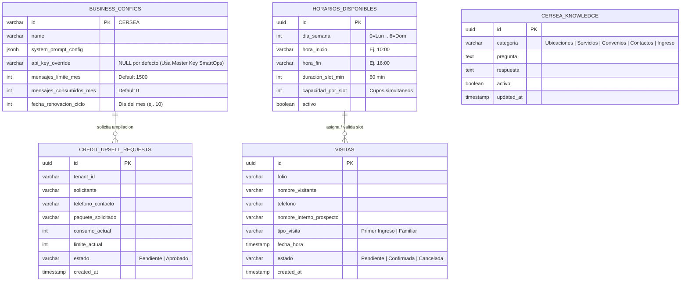

# Esquema Relacional y Capa de Datos (PostgreSQL)

## 💾 Proyecto: CERSEA WEB & BOT (Centro Cersea)

### Motor de Base de Datos
- **Motor:** PostgreSQL 16+ (`smartops_clients_pgvector` -> `multi_tenant_db`)
- **Extensiones Requeridas:** `uuid-ossp`, `pgvector`.
- **Requisito Crítico:** Control de concurrencia transaccional (`SELECT ... FOR UPDATE`) tanto al agendar visitas como al descontar créditos mensuales del tenant en `business_configs`.

---

### Diagrama Entidad-Relación (Mermaid)

---

### Especificación de Tablas Principales

#### 0. `business_configs` (Columnas del Gestor de Créditos Multi-Tenant)
En la tabla multi-tenant `business_configs` se agregaron las columnas para administrar el servicio "llave en mano" de IA:
| Columna | Tipo | Default | Descripción |
| :--- | :--- | :--- | :--- |
| `api_key_override` | `VARCHAR(255)` | `NULL` | Si es `NULL`, usa la Master Key de SmartOps en `.env`. |
| `mensajes_limite_mes` | `INT` | `1500` | Límite mensual de interacciones de IA contratadas por el cliente. |
| `mensajes_consumidos_mes` | `INT` | `0` | Contador atómico de mensajes respondidos por OpenAI en el ciclo actual. |
| `fecha_renovacion_ciclo` | `INT` | `10` | Día del mes en que se reinicia el contador de consumo mensual. |

#### 1. `credit_upsell_requests`
Registra las solicitudes enviadas desde el botón **"Solicitar más créditos"** en `/admin` para incrementar el paquete mensual por `+$500 MXN`.

#### 2. `cersea_knowledge`
Almacena las preguntas y respuestas predefinidas e información oficial del centro para inyectar al prompt del bot y sincronizar con `document_chunks` (`pgvector`).

#### 3. `visitas`
Almacena las citas de valoración (`Primer Ingreso`) y visitas familiares (`Familiar`) agendadas desde el bot o desde el Módulo de Agendamiento UI con bloqueo transaccional `FOR UPDATE`.

#### 4. `horarios_disponibles`
Define los bloques de tiempo que la clínica habilita por día de la semana y su capacidad máxima por bloque horario.
