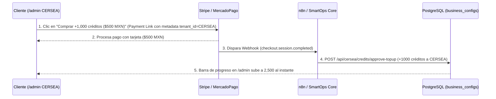

# Guía y Recomendación de Arquitectura: Conexión de Compra de Créditos / Tokens con el Gestor de Tenants (`multi_tenant_db`)

## 📌 Contexto Ejecutivo (SmartOps Agency)
En el modelo **SaaS Llave en Mano** de SmartOps, el cliente (`CERSEA` o cualquier otro tenant) no administra llaves de OpenAI ni lidia con facturación por token. Tú centralizas el consumo en tu cuenta maestra de OpenAI (`gpt-4o-mini`) y controlas el saldo mensual de cada cliente directamente en la tabla `business_configs` de tu base de datos PostgreSQL (`smartops_clients_pgvector` → `multi_tenant_db`).

---

## 🗄️ 1. Estructura Actual en Base de Datos (`business_configs` y `credit_upsell_requests`)

Cada cliente (tenant) en `business_configs` cuenta con las siguientes columnas de control de consumo:
- `id`: Identificador del tenant (ej. `'CERSEA'`).
- `api_key_override`: `NULL` por defecto (usa la Master API Key de SmartOps alojada en `.env`).
- `mensajes_limite_mes`: Límite de interacciones contratadas en el mes actual (ej. `1500`).
- `mensajes_consumidos_mes`: Contador atómico de mensajes respondidos en el ciclo actual (inicia en `0` y sube `+1` por respuesta).
- `fecha_renovacion_ciclo`: Día del mes en que se reinicia el consumo (ej. `10`).

Cuando el cliente presiona **"Solicitar más créditos"** en su panel `/admin`, se inserta un registro en `credit_upsell_requests` con estado `'Pendiente'` y se envía una alerta a tu `n8n` / `ntfy`.

---

## 🔄 2. Dos Formas de Conectar la Compra de Créditos con tu Gestor de Tenants

### Opción A: Flujo Semi-Automático (SPEI / Transferencia + Aprobación en 1 Clic desde SmartOps)
*Ideal cuando tus clientes en México te pagan los $500 MXN por transferencia bancaria o depósito y tú liberas el paquete desde tu panel maestro o vía `n8n`.*

1. **Solicitud del cliente:** El cliente da clic en **"Solicitar más créditos"** en `/admin` (`POST /api/cersea/credits/request-upsell`).
2. **Notificación a Emilio:** Recibes el aviso con el `request_id` y el consumo actual del cliente.
3. **Acreditación inmediata vía API:** Llamas al endpoint de acreditación (`POST /api/cersea/credits/approve-topup`) o ejecutas desde tu Gestor de Tenants / `n8n`:

```bash
curl -X POST https://api-core.smartopsia.com/api/cersea/credits/approve-topup \
  -H "Content-Type: application/json" \
  -d '{
    "tenant_id": "CERSEA",
    "creditos_extra": 1000,
    "request_id": "UUID-DE-LA-SOLICITUD",
    "notas": "Pago recibido por SPEI $500 MXN"
  }'
```

**¿Qué ocurre internamente en PostgreSQL?**
```sql
-- 1. Incrementa inmediatamente la bolsa mensual del tenant
UPDATE business_configs
SET mensajes_limite_mes = COALESCE(mensajes_limite_mes, 1500) + 1000
WHERE id = 'CERSEA';

-- 2. Marca la solicitud de upsell como Aprobada
UPDATE credit_upsell_requests
SET estado = 'Aprobado'
WHERE id = :request_id;
```
> **Ventaja clave:** Si el bot estaba en `1500 / 1500` devolviendo el mensaje de línea saturada, en el instante en que se ejecuta este endpoint pasa a `1500 / 2500` y **se reactiva automáticamente sin reiniciar ningún contenedor**.

---

### Opción B: Flujo 100% Automatizado (Stripe / MercadoPago Checkout + Webhook en `n8n` o `smartops-core`)
*Ideal para que el cliente pague con tarjeta a cualquier hora y sus créditos se sumen sin intervención humana.*



#### Pasos para activarlo en Stripe / MercadoPago + n8n:
1. **Payment Link con Metadata:**
   - Crea un enlace de pago por **$500 MXN** ("Paquete +1,000 Interacciones IA SmartOps").
   - Pasa en la URL `?client_reference_id=CERSEA` o en `metadata`: `{"tenant_id": "CERSEA", "creditos_extra": 1000}`.
2. **Flujo en `n8n` (2 nodos):**
   - **Nodo 1 (Webhook Stripe / MercadoPago):** Escucha el evento `checkout.session.completed` (o pago aprobado).
   - **Nodo 2 (HTTP Request o Postgres):** Llama a `POST http://smartops-core:8003/api/cersea/credits/approve-topup` enviando `{"tenant_id": "CERSEA", "creditos_extra": 1000}`.

---

## 🗓️ 3. Renovación Automática del Ciclo Mensual (Cron / n8n)

Para que el contador `mensajes_consumidos_mes` regrese a `0` automáticamente en el día de corte de cada cliente (`fecha_renovacion_ciclo`), programa en `n8n` un nodo **Schedule Trigger** (todos los días a las `00:05 AM`) conectado a un nodo **Postgres** con esta consulta:

```sql
UPDATE business_configs
SET mensajes_consumidos_mes = 0,
    mensajes_limite_mes = 1500
WHERE fecha_renovacion_ciclo = EXTRACT(DAY FROM CURRENT_DATE);
```

---

## 🛠️ 4. Endpoints Listos en `smartops-core` (`/api/cersea/credits`)

| Método | Endpoint | Propósito |
| :--- | :--- | :--- |
| `GET` | `/api/cersea/credits` | Consulta consumo actual (`mensajes_consumidos_mes`, `mensajes_limite_mes`, `%` y día de renovación). |
| `POST` | `/api/cersea/credits/request-upsell` | Disparado por el botón **"Solicitar más créditos"** en `/admin`; registra en `credit_upsell_requests` y avisa a `n8n` / `ntfy`. |
| `POST` | `/api/cersea/credits/approve-topup` | Suma `+N` créditos al `mensajes_limite_mes` del tenant en `business_configs` y aprueba la solicitud de upsell. |
| `POST` | `/api/cersea/credits/reset-cycle` | Reinicia a `0` los `mensajes_consumidos_mes` del tenant (para corte mensual o pruebas). |
